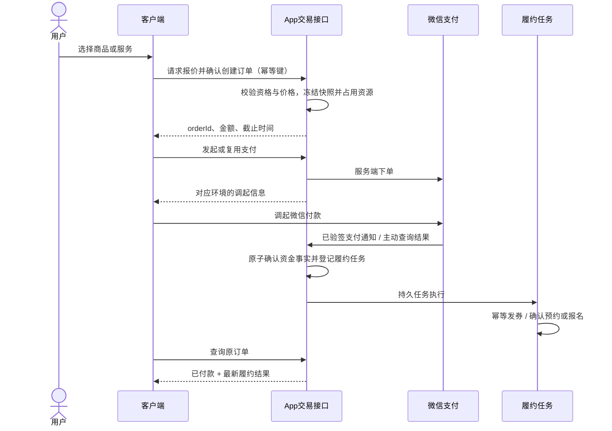

# 客户端在线收费适配方案

> 编制日期：2026-10-28；现状基线：1.6.2。
>
> 适用客户端：`apps/client-mobile`，Vue 3 + TDesign Mobile 的移动 Web。
>
> 文档性质：待实施方案。除“当前已实现”部分外，本文的页面、路由、接口、状态和模型均为建议契约，不表示已经开发或联调通过。
>
> **实施状态（2026-10-28）**：统一交易底座、租约账单缴费、商城/空间/活动现金订单、收银台、支付结果、现金交易、退款申请/进度、微信网页授权与后台能力开关的代码已落地；默认模块开关关闭，需在后台配置并启用微信收款后逐模块开放。真实 JSAPI/H5/Native 商户产品权限、公网回调、小额支付/退款与对账验收仍需在具备条件的隔离/生产环境完成。审核型收费、收费候补、部分退款、企业成员财务授权与支付宝仍按本文保持未开放。

## 1. 目标与范围

让用户在客户端完成“查看收费标准 → 确认商品或服务 → 微信支付 → 查询结果 → 使用权益 → 申请退款”，并能在“我的”找回未完成交易。沿用现有五个底部入口：首页、需求、社区、广场、我的，收费功能通过业务页面和个人中心接入，不新增底部支付 Tab。

本方案沿用已确认的客户自营普通商户、客户自己的商户号、APIv3、公钥验签；微信内网页采用 JSAPI，微信外手机浏览器采用 H5，PC 展码采用 Native。商户产品权限与真实支付条件仍需验收。

| 模块 | 本次适配范围 | 明确边界 |
| --- | --- | --- |
| 商城 | 积分兑换继续使用原流程；现金商品接入确认订单、支付、券码和退款 | 每件商品只采用一种计价方式，不支持积分加现金；首期沿用单商品、单件、券码核销模型 |
| 公共空间 | 免费、积分预约继续保留；现金预约接入时段确认、支付及预约状态 | 现金和积分费用互斥；现金按小时计费；付款前必须处理时段占用 |
| 活动 | 免费报名保留；收费活动增加收费说明、报名资格、待付款及电子票 | 活动奖励积分不等于报名收费；审核、候补和付款分别处理 |
| 工位/办公室租约 | 在本人或获授权企业租约下查看已出账单、缴费及交易历史 | 由后台出账，不做客户端选工位签约、自动续租、押金或自动扣款 |
| 需求/项目 | 保留现有业务功能和已有历史记录 | 收费方式尚未确定，本轮不新增付费发布、项目付款或收费入口 |
| 支付宝 | 预留未来扩展结构 | 当前不显示可付款选项，不发起支付宝请求 |

“不混合支付”在本项目中的含义：商品或空间的一条业务记录只配置一个有效价格，客户端按该价格进入对应流程，用户不能自行把现金订单改成积分订单，也不提供积分抵现。

## 2. 当前已实现与待补能力

### 2.1 当前已实现

- 后台可在“系统配置 → 收款配置 → 微信”输入商户参数、上传密钥文件、保存及启停；支付宝显示暂未开通。
- 后端已有应收账单、后台 Native 收款、支付结果通知、主动查单、超时关单、全额退款审批及补偿基础。
- 商品和空间已下发 `chargeAmountFen`，客户端可显示人民币价格；现有积分接口会拒绝现金商品和现金空间，避免按 0 积分免费完成。
- 商品 `validDays=0` 已表示不过期，新积分兑换券码的空到期时间显示“长期有效”，过期任务不会处理该券。
- 客户端已有积分兑换订单、空间预约、活动报名/电子票、我的租约页面及 App JWT 登录。

### 2.2 仍需实施

| 缺口 | 对客户端的影响 |
| --- | --- |
| 缺少 `/api/app/**` 现金交易接口 | 当前不能直接在客户端创建现金订单、支付或退款申请 |
| JSAPI/H5 只有后端通道适配方法 | 尚无完整网页授权、客户端调起和支付返回流程 |
| 独立应收账单未绑定自动业务履约 | 当前收款不能自动发券、确认预约或生成收费活动电子票 |
| 尚无现金交易列表、收银台、支付结果页 | 用户无法在客户端续付、查款或追踪退款 |
| 库存/时段/名额尚无现金待付款占用机制 | 不能直接把现有免费或积分提交接口改成“先付款” |
| 活动原报名接口未接入现金校验与待付款资格 | 后台设置活动价格，不能视为客户端已阻止未付款报名/取票；开放收费前必须补齐后端控制 |
| 缺少完整渠道对账闭环 | 正式收费前需补交易账单下载、逐笔差异及处理流程 |

当前“联系运营购买/预约”是过渡行为。只在对应模块的后端订单、支付和履约链路全部完成并验收后，替换为在线支付入口。

## 3. 信息架构与页面增强

### 3.1 现有页面

| 页面 | 现有路径 | 增强内容 |
| --- | --- | --- |
| 商城列表/详情 | `/mall`、`/mall/:id` | 明确显示积分或现金价格；现金商品主按钮改为“立即购买”；展示有效期、交付方式、退款约定 |
| 空间列表/预约 | `/spaces`、`/spaces/:id/reserve` | 显示每小时费用、计费时长和总额；现金流程进入确认订单，积分流程继续展示实扣积分 |
| 活动详情 | `/events/:id` | 显示免费或每人次现金费用；按钮按待审核、候补、待付款、已报名、已结束切换 |
| 我的兑换订单 | `/me/orders`、`/me/orders/:id` | 保持原积分订单和券码能力；现金券码可以关联展示，但退款必须进入现金售后流程 |
| 我的预约 | `/me/reservations`、`/me/reservations/:id` | 关联现金交易入口，分别展示审核、付款及预约状态 |
| 我的报名 | `/me/enrollments` | 增加“待付款”“查看交易”；未付款不显示可用票券或签到入口 |
| 我的租约 | `/me/leases` | 增加本期账单、待缴总额、到期日和“去缴费”；无账单时明确显示“暂无待缴账单” |
| 我的 | `/me` | 增加“现金交易”入口及待付款/退款处理中数量；原“兑换订单”等业务入口保留 |

商城页面可将产品文案从“积分商城”逐步调整为“商城”，积分规则仍保留独立入口；不改变原路由或用户已有订单链接。

### 3.2 新增页面建议

以下均为拟新增路由，必须使用客户端身份鉴权，不能转到管理员收款页面。

| 页面 | 建议路径 | 核心内容及主操作 |
| --- | --- | --- |
| 确认订单 | `/checkout/confirm?quoteId=…` | 业务摘要、购买/预约主体、金额、退款约定、付款截止时间；主操作“确认并支付” |
| 统一收银台 | `/checkout/:orderId` | 商户名称、业务摘要、应付金额、当前可用微信方式及倒计时；主操作“微信支付” |
| 支付结果 | `/checkout/:orderId/result` | 从后端获取付款及履约结果；主操作指向“查看券码/预约/电子票/账单” |
| 现金交易列表 | `/me/transactions` | 全部、待付款、待使用/待履约、已完成、退款/售后；支持按业务筛选 |
| 现金交易详情 | `/me/transactions/:orderId` | 收款事实、业务快照、履约状态、退款记录及操作 |
| 申请退款 | `/me/transactions/:orderId/refund` | 原实付金额、退款约定、资格提示、原因；首期申请整单全额退款 |
| 退款进度 | `/me/refunds/:refundRequestId` | 申请、审核、渠道处理中、成功或异常；区分申请被拒绝和渠道处理异常 |

订单号等 URL 参数只用于定位资源；金额、主体权限和订单归属必须在后端重新校验。浏览器地址不携带 JWT、密钥、OpenID 或可直接使用的支付凭据。

### 3.3 个人中心与业务详情的关系

“现金交易”承载统一资金状态，“兑换订单/我的预约/我的报名/我的租约”承载业务权益。通过 `orderId` 与业务记录互相跳转，同一笔款不会重复建成多个收款对象。

现金商品付款后生成券码，用户仍能从商品交易详情打开券码；已有积分券码继续使用原详情。积分退款退积分，现金退款退原支付，不共用一个含糊的“退款”接口。

## 4. 分模块交互与计费规则

### 4.1 商品

1. 详情页按后端返回的计价方式显示“100 积分”或“¥29.90”，不同时显示两个有效售价。
2. 积分商品沿用原余额预览、等级积分折扣、扣分和券码流程；积分优惠不自动用于现金售价。
3. 现金商品首期每单一件，点击“立即购买”请求报价；后端校验上下架、库存、可见/购买资格及当前价格。
4. 确认订单时占用库存并冻结价格、有效期和退款约定；支付成功后幂等发券，业务到期时间由后端计算。
5. `validDays=0` 显示“长期有效”；大于0显示具体使用截止时间；历史 `null` 继续按现行30天默认兼容，不批量改成不过期。
6. 建议有效期从后端确认付款、权益生效的时间起算；该口径需在实施时统一到履约规则，客户端不自行计算最终到期日。

券码未发放完成时显示“已付款，券码生成中”，不能显示付款失败并引导再买一单。重新进入页面仍定位原交易。

### 4.2 公共空间

- 免费：积分和现金费用均为0，保留原免费预约。
- 积分：沿用每小时积分、现有等级折扣和积分退回规则。
- 现金：展示小时单价、开始/结束时间、计费小时数、应付总额、预约主体及退款规则；不扣积分。

现金计费建议沿用现有时长口径：不足一小时按一小时计费。例如10:00–11:30按2小时计算，23:59结束的全天空间也由后端统一计算。客户端仅预览，最终取报价中的整数分金额。

无需审核的现金预约：校验资格及冲突 → 占用时段并形成待付款订单 → 付款 → 预约确认。

需要审核的现金预约，建议采用“先审核资格，审核通过后重新确认时段及价格，再开放付款”。审核未通过不收款；审核通过不能跳过最新冲突检查。是否在审核期保留时段、保留多久属于运营政策，未确定前不开放该分支。

待付款占用必须纳入现有空间冲突判断，与积分预约、免费预约、已发布活动及后台占用共用规则。前端不能仅通过禁用已选时段代替后端并发控制。

### 4.3 活动

免费活动继续使用原报名、审核、候补和签到。收费活动在详情展示每人次价格、举办/改期时间、报名条件和退费约定；奖励积分单独标注“报名/签到奖励”，不作为可抵扣现金。

建议流程：

| 场景 | 推荐行为 |
| --- | --- |
| 无审核且有名额 | 校验资格、占用名额、付款；确认到账后形成有效报名 |
| 需审核 | 先审核；通过后校验剩余名额并发放限时付款资格 |
| 已满员 | 加入候补，不提前收款；递补后校验资格并提供付款窗口 |
| 用户退出微信支付 | 保留原待付款报名；后端查单确认，用户可在窗口内继续支付 |
| 未付超时 | 查询并关闭支付后回收占用，按候补规则递补 |
| 活动取消/改期 | 展示通知及退款入口；批量退款或用户申请由明确政策驱动，不将通知发送等同于退款成功 |

需要新增“待付款资格”或等价业务状态，不能用现有 `approved` 假装未付款报名已有效。电子票、签到接口、报名列表及名额统计都必须检查付款资格，不能只修改客户端按钮。

### 4.4 工位/办公室租约

首期采用“后台出账，客户端缴费”，不根据租约页面中的租金字符串在前端直接生成收款金额。

租约卡片显示待缴账单数量及到期提醒；账单详情展示账期、费用说明、应收、已收、退款及购买主体。选定账单后进入统一收银台；付款不会自动改变租期、分配办公位或生成续租合同。

个人账单仅本人可操作。现有企业租约可见规则主要面向负责人，后续若允许其他成员缴费，必须新增明确的账单查看/支付授权；“能看企业名片”或持有普通企业身份不自动获得财务权限。自定义且未绑定账号的承租方，首期继续由运营收款，不提供匿名链接付款。

### 4.5 需求与项目

本轮不出现收费入口、支付提示或待付款状态；预算、合同金额展示不转成应收。已有历史现金交易可按归属查询及走原售后，但不能据此恢复新收费能力。

## 5. 统一支付体验

### 5.1 收银台结构

按顺序展示：商户名称 → 商品/服务摘要 → 购买主体 → 应付金额 → 退款约定摘要及全文入口 → 付款截止时间 → 可用支付方式 → 主操作。

首期只有微信。支付宝不显示为可选或可点击支付方式；不能将后台的“支付宝暂未开通”配置卡直接复制为客户端可用选项。

底部固定操作栏显示最终金额及“微信支付”，正文为其预留高度和安全区。发起中展示 loading，禁止重复提交；支付被取消后恢复可操作状态，但先核实原支付单，不自动重建订单。

### 5.2 环境适配

| 访问环境 | 计划方式 | 必须满足的条件/交互 |
| --- | --- | --- |
| 微信内手机网页 | JSAPI | 完成本站登录、公众号网页授权及对应AppID下OpenID关联；后端生成调起参数，授权目录配置正确 |
| 微信外手机浏览器 | H5 | 后端返回支付链接并跳转；配置H5支付域名，用户返回后查询原订单 |
| PC或另一块屏幕展码 | Native | 经用户授权的交易生成二维码，提示用手机微信扫一扫；页面查询后端状态 |
| 不支持的浏览器或缺少产品权限 | 不发起 | 显示原因和返回业务入口；不能伪造二维码或擅自降级成其他人的收款链接 |

Native 二维码不能按“长按/相册识别即可付款”设计，因此不作为手机同屏付款的默认兜底。[W3]

JSAPI使用用户在下单AppID下的OpenID。[W1] 微信身份不等于本站登录身份；本方案要求网页授权回跳使用后端生成、单次消费的state，绑定当前登录会话和订单，客户端不接受任意传入的OpenID。

H5需补齐商户站点登录态、Origin白名单及跨域预检等校验。现客户端使用Bearer JWT，必须设计与官方H5登录态要求的衔接并实测，不把现有JWT鉴权视为H5安全条件已经满足；终端IP由后端基于受信任网关获取。[W2]

H5返回页只恢复上下文，不能用“微信返回”“success参数”或客户端回调作为收款凭证。授权、支付返回地址均受白名单限制，禁止开放跳转。[W1][W2]

### 5.3 结果页与恢复

| 后端状态 | 客户端展示 | 可用操作 |
| --- | --- | --- |
| 未付款且仍可支付 | 待付款、金额及截止时间 | 继续付款、申请取消 |
| 付款状态未确认 | 正在确认付款结果，请勿重复支付 | 查询结果、稍后从现金交易查看 |
| 已付款、履约待处理 | 已付款，正在准备券码/确认预约 | 查看交易、联系运营；不再次付款 |
| 已付款且权益可用 | 支付成功及业务摘要 | 查看券码/预约/电子票/账单 |
| 已确认关闭且未付款 | 订单已关闭 | 返回业务页重新选择；新价需重新确认 |
| 退款处理中/成功 | 显示实际退款金额及时间线 | 查看退款进度 |
| 人工核对 | 显示资金结果待核对 | 联系运营、查询；禁止新付覆盖原款 |

建议结果页按2秒、3秒、5秒等退避节奏查询本站后端，约30秒未确认后停止自动前台轮询并保留查询入口；页面隐藏/卸载停止定时器，恢复可见时补查。该节奏是项目UX建议，不是微信接口调用频率要求；后台持续补偿不依赖页面在线。

倒计时以服务器 `serverTime` 与 `expiresAt` 校正；归零只是提示，不能直接认定支付失败、释放资源或创建新支付单。

## 6. 后端必须配套的契约

以下为拟新增的项目接口，均未实现；不能让客户端调用 `/api/admin/commerce/**` 或系统商户配置接口。

### 6.1 App API 建议

| 方法及路径 | 用途 | 关键约束 |
| --- | --- | --- |
| GET `/api/app/commerce/capabilities` | 返回当前用户/环境可用渠道、模块与不可用原因 | 仅下发公开能力；不能泄露商户密钥或将本地ready直接当作生产已验收 |
| POST `/api/app/commerce/quotes` | 商品、空间、活动确认前报价 | 输入来源及必要选择；主体由会话及授权确定，金额由后端计算 |
| POST `/api/app/commerce/orders` | 从报价创建/复用待付款订单和资源占用 | quoteId + 幂等键；复查价格、资格、库存/时段/名额 |
| GET `/api/app/commerce/orders/:id` | 收银台和结果页读取 | 校验归属，返回资金和履约双状态 |
| POST `/api/app/commerce/orders/:id/payments` | 发起或复用微信支付 | 渠道仅作请求提示，后端检查环境和能力；不接收客户端自定金额 |
| POST `/api/app/commerce/payments/:id/sync` | 查询原支付结果 | 校验归属并限频，复用原单，不能由客户端写成功状态 |
| POST `/api/app/commerce/orders/:id/cancel` | 请求取消未付订单 | 先查单/关单，确认安全后回收资源，存在已付不得走未付取消 |
| GET `/api/app/me/transactions` | 我的现金交易分页 | 本人或明确授权企业；支持业务/状态筛选 |
| GET `/api/app/me/bills` | 本人/授权企业可缴账单 | 租约入口使用现成billId，不允许前端按任意租金、账期出账 |
| POST `/api/app/commerce/bills/:id/orders` | 从已出应收形成缴费上下文 | 保留原账单金额，禁止重复创建应收或重复缴款 |
| POST `/api/app/commerce/orders/:id/refund-requests` | 用户提交全额退款申请 | 归属、支付事实、业务退款资格、重复申请及额度校验 |
| GET `/api/app/commerce/refund-requests/:id` | 用户查看售后进度 | 不暴露管理员账号等内部字段 |

另需新增微信网页授权起点与回调接口，绑定App登录会话；精确路径及会话方案在接口设计阶段冻结。授权流程和支付结果通知是两条独立链路。

### 6.2 前后端数据分工

**报价建议返回：** quoteId、来源类型/ID、priceVersion、计价方式、数量/计费小时、整数分单价与总额、必要的积分预览、主体摘要、有效期/退款政策快照、报价截止时间。客户端不拼装最终应收金额。

**现金订单建议返回：** orderId、billId、sourceType/sourceId、购买主体摘要、amountFen、paidFen、refundedFen、付款/审核/履约/售后状态、serverTime、expiresAt、业务详情链接、当前允许的动作及不可操作原因。

**发起支付建议返回：** paymentId、实际方式、支付尝试截止时间，以及该方式专属的JSAPI参数/H5链接/Native二维码内容；按需返回，避免所有凭据一次下发。支付调起信息只保存在当前交互内存中，刷新后按原订单恢复，不长期缓存。

必须区分业务订单、应收账单、支付尝试和退款申请ID。浏览器只保存可找回的orderId，不把最新二维码链接当作订单身份。

报价过期或价格变化时返回明确的业务错误码及新报价，要求重新确认；不能静默按上涨后的价格付款。已创建订单以自己的价格和政策快照为准。

现有业务表尚无统一的报价版本机制；`priceVersion`需在后端新增设计，可使用受控版本号或价格/政策/有效期的快照摘要，不能直接假定当前已有此字段。

## 7. 交易与履约设计

### 7.1 状态分层

建议把付款、履约、审核和售后拆开，避免一个 `status=success` 同时表达收到钱和权益已经可用。

| 维度 | 建议状态示例（尚未冻结） |
| --- | --- |
| 付款 | unpaid / confirming / paid / closing / closed / attention |
| 审核 | not_required / pending / approved / rejected |
| 履约 | not_started / pending / ready / used / cancelled / exception |
| 售后 | none / requested / rejected / processing / refunded / exception |

现有CommercePayment/CommerceRefund及积分订单已有状态不能直接替换成此表；后端应建立明确映射。展示动作以服务端allowedActions为主，客户端再叠加加载/离线限制。

### 7.2 复用现有交易底座的边界

1. 新建客户端业务订单与资源占用记录，关联既有CommerceBill和支付/退款记录，避免再建第二套现金账本。
2. 区分“后台手工应收”和“客户端业务订单”的来源及履约模式。旧后台账单不能因新增任务而被自动发券、自动报名或再次占库存。
3. 客户端重复购买同一商品是合法的新交易。现有以来源/主体/账期/标题防重的应收键不能直接用作所有零售订单键；建议由稳定业务orderId建立唯一关联，重试复用原orderId及幂等键。
4. 同一账单不能有多笔未确认支付；重复点击、刷新、网络超时返回时复用原尝试。
5. JSAPI/H5/Native的下单参数不同。环境切换不能沿用原商户单号修改支付方式；先查询并确认旧尝试安全关闭，再建立新尝试，已成功则直接展示原结果。
6. 付款确认与持久履约任务登记置于同一数据库事务；履约按orderId唯一执行，失败可重试，不依赖客户端回调再次调用“发券”。

### 7.3 资源与异常

- 商品需有可售库存与待付款占用，付款履约、取消释放、退款回补均幂等，不能既在占用时扣一次、发券时再扣一次。
- 空间待付款时段必须进入统一冲突判断；活动待付款名额必须参与容量统计，不能在每个页面各算一套余量。
- 建议首期付款窗口参考现有15分钟，并由后端统一配置；JSAPI/H5调起信息自身的有效期与业务订单窗口分别管理，不共用一个盲目固定倒计时。
- 超时回收由后端查单、关单及状态锁协调，前端倒计时不能释放资源。结果未知时进入核实/人工处理，不能继续出售同一占用并假定旧款失败。
- 确认收到钱但资源无法兑现时，展示“已付款，待处理”，登记异常并进入补偿/退款处置；不能改成未付款，也不能生成可使用的假券码。
- 旧免费/积分订单维持原价格和有效期快照；业务改成现金价后，不改变已经存在的积分券码、预约或退款金额。

## 8. 退款与售后适配

现金交易详情明确展示实付、退款约定、是否可申请及原因。首期只申请整单全额退款，沿用后台异人审批；客户端无审批、直接改退款金额或修改资金终态的权限。

“申请已提交”“审核通过”“微信处理中”“退款成功”分别展示。用户关闭页面、审核受理或HTTP请求成功都不等于退款成功；最终以服务端核实结果为准。

售后与业务状态联动：提交有效退款申请时，后端原子冻结可退款的券码/预约/报名权益，避免申请中继续核销或签到；审批拒绝后按当时业务资格恢复；退款成功后取消权益并按规则回补资源。已使用、已签到、临近或已开始的预约是否可退，由明确政策决定。

免费/积分取消仍走原流程；现金取消必须走现金售后，不能调用原“退积分”接口结束现金交易。过期现金券的退款是否自动申请需单独确定，不能把现有积分过期任务直接复用于现金原路退款。

渠道异常显示“退款处理中/需人工处理”，保留申请编号及联系运营入口；后端继续补偿。渠道退款通知、异常退款处置及对账应在正式收费前补齐，不能依赖用户不断点击查询。

## 9. 客户端工程改造清单

以下新增文件名为建议，实施时按仓库约定最终命名。

| 位置 | 计划调整 |
| --- | --- |
| `src/router/index.ts`、`src/constants/pageTitles.ts` | 注册收银台、结果、现金交易、退款页；设置登录要求、标题及返回路径 |
| `src/utils/profileMenu.ts`、`src/views/mobile/MeView.vue` | 增加现金交易入口与待办数量，不改五Tab结构 |
| `src/api/commerce.ts`（新增）、`src/types/index.ts` | 封装App交易接口、报价及双状态DTO；不导入管理员配置API |
| `src/utils/paymentEnvironment.ts`（新增） | 判断可用运行环境，结果交后端复核；不单凭UA决定可支付能力 |
| `src/composables/usePayment.ts`（新增） | 发起防重、JSAPI/H5/Native分支、返回恢复、轮询与定时器清理 |
| `src/utils/money.ts`（新增或复用） | 整数分显示人民币两位小数；客户端不参与可信金额结算 |
| `src/components/commerce/`（新增） | MoneyDisplay、PaymentActionBar、TransactionStatus、RefundTimeline、PolicySummary等复用组件 |
| `MallView.vue`、`MallDetailView.vue` | 从过渡提示升级为现金购买；保留积分分支和长期有效展示 |
| `SpacesView.vue`、`SpaceReserveView.vue` | 对接现金报价及确认，不调用积分接口提交现金预约 |
| `EventDetailView.vue`、`MyEnrollmentsView.vue` | 收费提示、审核/候补/待付款状态及电子票门槛 |
| `MyLeasesView.vue` | 可缴账单及统一收银台跳转，企业财务授权由后端决定 |
| `MyOrdersView.vue`、`MyOrderDetailView.vue`、预约详情等 | 关联交易，区分现金售后和积分取消，保留旧链接 |
| `src/api/http.ts`、授权与主题相关模块 | 统一处理会话失效/离线/错误码，复用现有主题、品牌及安全区规则 |

前端界面沿用TDesign Mobile、现有StateTag/EmptyBlock/ListSkeleton/FlowResult、字体及主题token，不另建视觉体系。金额完整显示；长名称可换行，订单号可复制。错误持续可见、有明确重试路径；弹层关闭恢复焦点。

适配320、375、390、430 CSS px、系统大字体、浅/深色主题。触控目标至少44×44 CSS px，固定支付栏不遮挡最后一项、输入错误或系统手势区域。每屏一个主操作，确认结果不自动强制跳转，也不以庆祝动画掩盖履约待处理状态。

## 10. 实施顺序与开放条件

| 阶段 | 客户端交付 | 必须同时满足的后端条件 | 开放范围 |
| --- | --- | --- | --- |
| P0：冻结契约 | 确认路由、DTO、状态、错误码和页面结构 | 订单/账单关联、主体授权、报价与资源占用方案冻结 | 只保留当前展示及联系运营 |
| P1：统一交易与租约缴费 | 收银台、结果、现金交易列表/详情，租约已出账单缴费 | App鉴权、JSAPI/H5完整链路、查询关闭、退款入口、对账与运维验收 | 先开放不依赖自动发券/预约的已出账单，范围受能力开关控制 |
| P2：现金商品 | 商品确认订单、付款后券码、全额售后 | 库存占用、幂等发券、有效期快照、权益冻结与退款 | 仅券码模型商品，首期单件 |
| P3：现金空间 | 时段报价、支付后预约和售后 | 统一冲突锁、占用回收、审核分支及资金异常补偿 | 优先无需审核空间；审核政策明确后再开放需审核空间 |
| P4：收费活动 | 名额、审核、候补、待付款与电子票 | 名额占用、电子票资格、递补窗口、取消/改期退款规则 | 按运营规则逐类开放 |

阶段编号表示依赖顺序，不代表已批准上线。各模块独立能力开关，由后端返回可用状态；不能因为微信参数已保存或某个模块通过测试，就同时打开所有“立即支付”。

管理员关闭发起收款或许可证到期时，不能新建付款；存量结果查询和退款收尾继续可达。客户端须显示原因，并区分“发起入口已关闭”和“原二维码已经失效”，后者必须由后端确认。

## 11. 验收矩阵

| 类别 | 至少覆盖的场景 | 通过标准 |
| --- | --- | --- |
| 定价 | 积分/现金/免费、价格变化、旧订单、0天有效期 | 单一有效计价；不混用折扣；不过期及历史快照正确 |
| 安全 | 未登录、他人订单、企业越权、篡改金额/主体、失效授权state、非法返回地址 | 后端拒绝越权和篡改，不泄露商户凭据或其他用户订单 |
| 防重 | 双击、刷新、提交超时、跨设备和切换环境 | 同一业务幂等；未确认支付不产生可并行付款的新尝试 |
| 微信环境 | 微信内JSAPI、外部手机H5、PC扫码、缺少权限、用户取消/调起失败 | 选择正确方式；返回后查单；不依赖长按Native二维码 |
| 资金确认 | 延迟通知、重复通知、丢通知、查询未知、超时/关单竞态 | 客户端不写成功；后台补偿；金额和履约不会重复 |
| 履约 | 库存/时段/名额竞争，任务失败重试，已付未发券 | 不超卖、不重复发券；已收款故障保留原款事实和处理入口 |
| 售后 | 重复申请、审批拒绝、处理中、渠道异常、退款与核销并发 | 不超退；申请/处理中/成功区分；权益与资金一致 |
| 生命周期 | 返回、切后台、断网、重新登录、关闭开关、许可证到期 | 找回原交易；清理前台定时器；存量查询/售后不丢失 |
| 界面 | 窄屏、大字体、深色、安全区、读屏/键盘、长名称/大金额 | 正文无横向溢出，金额/主按钮/错误完整可见 |

本文件不新增或执行测试。实施时先在已授权的本地/隔离环境用mock通道覆盖资金与业务状态，再在具备商户权限、公网回调及明确授权后执行真实微信安全验证、小额支付/退款和真实设备验收。模拟成功不能替代真实渠道验收。

## 12. 待确认的业务政策

以下事项不阻塞本方案文档交付；实施对应分支前需要业务结论，不使用客户端默认值静默决定。

| 事项 | 建议起点 | 未确认时的处理 |
| --- | --- | --- |
| 商品有效期起算点 | 后端确认付款、权益生效时起算，0为永久 | 冻结到期口径后再开放现金发券 |
| 预约/活动审核与收费顺序 | 先审核、后限时付款，付款前重新核验资源 | 审核型现金业务继续联系运营 |
| 候补与待付款窗口 | 候补不预收款，递补后限时付款 | 不开放收费候补 |
| 取消、临期、已使用及过期售后 | 首期全额退款，具体资格按明确约定 | 不做前端自动判退或直接放款 |
| 企业可查看及可缴费人员 | 负责人起步，后续增加显式财务授权 | 普通企业成员无财务能力 |
| 现金优惠、部分退款、多件购买 | 首期不做，避免改变已冻结的简单模型 | 不显示相关输入或入口 |
| 需求/项目与支付宝 | 后续另立方案 | 本轮保持暂停/未开通 |

## 13. 依据与相关文档

项目事实依据：

- [交易经营实际实现](./commerce-implementation.md)、[整体在线收费规划](./online-payment-enhancement-plan.md)、[客户端Wiki](./wiki-client-mobile.md)、[App API设计](./api-app-design.md)。
- `apps/client-mobile/src/router/index.ts`、`views/mobile/AppShell.vue`、`utils/profileMenu.ts`：现有导航与入口。
- `apps/client-mobile/src/views/mobile/MallDetailView.vue`、`SpaceReserveView.vue`、`MyOrderDetailView.vue`：现金过渡提示、积分流程与长期有效展示。
- `apps/api/src/modules/app/mall/mall.service.ts`、`app/spaces/spaces.service.ts`、`app/events/events.service.ts`、`app/leases/leases.service.ts`：现有App业务与主体边界。
- `apps/api/src/modules/commerce/`：目前仅管理端交易入口、微信通知、渠道适配及后台配置；不等于已存在App收银接口。

微信支付官方依据通过 `wechatpay-payment-integration` skill 检索并读取；本地知识库根目录为 `C:/Users/Gaoshuo/.codex/skills/wechatpay-payment-integration/assets/微信支付官网文档/`：

| 引用 | 官方文档 | 对应本地路径 |
| --- | --- | --- |
| W1 | [APIv3/普通商户/支付产品/JSAPI支付/开发指引](https://pay.weixin.qq.com/doc/v3/merchant/4012791870) | `APIv3/普通商户/支付产品/JSAPI支付/开发指引-4012791870.md` |
| W2 | [APIv3/普通商户/支付产品/H5支付/开发指引](https://pay.weixin.qq.com/doc/v3/merchant/4012791831) | `APIv3/普通商户/支付产品/H5支付/开发指引-4012791831.md` |
| W3 | [APIv3/普通商户/支付产品/Native支付/开发指引](https://pay.weixin.qq.com/doc/v3/merchant/4012791891) | `APIv3/普通商户/支付产品/Native支付/开发指引-4012791891.md` |

界面方案参考 `mobile-app-ui-design`、`ui-ux-pro-max`，按现有TDesign Mobile及项目token适配。本文的阶段、接口命名、状态拆分、资源占用和轮询节奏是项目设计建议，并非微信官方接口定义或强制产品规则。
