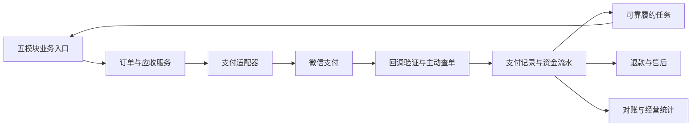

# 聚屿社区在线收费与经营能力增强方案

> 日期：2026-10-28
>
> 状态：整体规划；已开始第一批后端与后台实施，不代表支付已联调或已具备上线条件。
>
> 范围：管理后台 UI、后端、客户端 UI；覆盖需求/项目、办公位（工位）、空间、活动、商城。
>
> 本文最初为只读评估产物。2026-10-28用户授权开始后端与后台实施；实际已实现能力及未完成项见 [交易经营实现说明](./commerce-implementation.md)。本文其他章节仍是整体规划，不表示已全部交付；未调用真实支付接口。

2026-10-28 补充约束：客户确认自营普通商户、JSAPI/H5/Native、APIv3、公钥验签。收费设置必须回归原业务新增/编辑表单，独立 `/commerce/services` 页取消；后台系统配置增加收款指引与状态检查。当前实现按业务单价及数量生成独立应收，不自动履约；后续客户端收银台与实时资源锁等仍按规划推进。

1.6.2 当前约束：需求/项目收费方式尚未决定，暂移其新增/编辑收费控件及新出账能力，历史保留。商品、空间分别互斥选择积分或现金，禁止混合支付；商品有效期0为长期有效。收款配置为系统配置一级栏目，二级微信（参数输入/文件上传/保存）及支付宝（暂未开通）。下文其余完整产品链路仍是规划。

## 1. 目标与方案边界

让客户能够在现有社区运营系统中出售服务、出租资源、销售活动门票和商品，并完成收款、履约、退款、催缴及对账。支付能力带来收费闭环；盈利仍需要客户建立定价、销售与履约能力，不能以成交总额代替利润。

建议首期采用“统一交易底座 + 五个业务模块收费适配 + 后台经营管理 + 客户端统一支付体验”。所有新增模型、路由、权限码及组件名均为建议命名，尚未写入工程，也不覆盖现有冻结契约。

### 1.1 交付范围与待定条件

| 分类 | 内容 |
| --- | --- |
| 已明确目标 | 五个模块能够在线收费；规划后台、后端和客户端的增强能力 |
| 建议首期路径 | 客户自营商品及服务由实际卖方收款，保留免费与原积分业务 |
| 商务待确认 | 实际卖方和收款主体、商户资质、首批收费项目、价格、退订政策、主要付款入口 |
| 已确认接入要素 | 客户自营普通商户，JSAPI/H5/Native，APIv3，微信支付公钥验签；授权配置及产品权限仍待核实 |
| 后续范围 | 多商户入驻、交易佣金、分账结算、自动扣费、充值余额、积分加现金、复杂营销、实物配送 |
| 当前实施边界 | 已授权后端和后台第一批开发及本地/隔离测试；未授权真实接口调用和生产部署 |

需求/项目包含两种不同关系：运营方向用户提供收费服务；需求方向承接方支付项目款。第三方项目款需先确定资金路径，不能默认由运营方代收后人工转付。

### 1.2 项目现状与可复用资产

| 领域 | 现状证据 | 增强方向 |
| --- | --- | --- |
| 技术基础 | Vue 3 + TDesign 双前端；NestJS + Prisma + PostgreSQL + Redis 后端 | 沿用现有技术栈，新增共用交易域 |
| 需求/项目 | 预算、报价、合同价格、里程碑与验收；合同价格是展示字符串 | 新增正式报价、收费服务及分期应收 |
| 办公位 | 租约、周期租金、续期与合同附件；尚无缴费账单 | 新增周期应收、缴费与催缴 |
| 空间 | 预约、审核、冲突锁、积分计费与退分 | 保留积分语义，另增现金价格和待支付资源锁 |
| 活动 | 报名、审核、候补、电子票、签到 | 新增票价、付款资格与付费票履约 |
| 商城 | 积分兑换、库存、现场券码核销、退分 | 新增现金购，支付后发券 |
| 公共设施 | RBAC、审计、消息发送队列、调度、许可证及归档治理 | 扩展交易权限、可靠履约任务和资金记录保护 |

主要依据见第 12 节。预留的微信字段不能证明网页授权和支付已经接通；现有“退款”大多是退积分，不能作为现金退款实现使用。

## 2. 商业化产品与收费流程

### 2.1 五模块最小收费场景

| 模块 | 首期可收费产品 | 推荐流程 | 后续能力 |
| --- | --- | --- | --- |
| 需求 | 发布、精选展示、撮合等运营服务，由客户选择实际提供的项目 | 服务说明与审核 → 正式报价/订单 → 付款 → 发布或执行服务 → 交付 | 服务套餐、成果收费、会员权益 |
| 项目 | 客户自营项目首款、阶段款、尾款 | 确认合同与收款计划 → 到期应收 → 付款 → 交付验收 | 第三方项目收款、佣金和结算 |
| 办公位 | 已签租约的周期租金、续租费用 | 签约 → 出账 → 通知 → 在线缴费 → 核销应收 → 续租/退租 | 自助选位、押金、补差与退租结算 |
| 空间 | 按时段收费的会议室、路演厅等 | 选时段 → 审核（如需）→ 限时付款 → 预约生效 → 使用 | 包场、套餐、周期预约 |
| 活动 | 单一票价的活动/培训报名 | 报名审核（如需）→ 限时付款 → 票据生效 → 签到 | 多票档、早鸟票、团体票 |
| 商城 | 现金购买商品券、服务券 | 下单锁库存 → 支付 → 发券 → 核销 → 售后 | 积分抵扣、购物车、配送 |

首期商城沿用现场核销，避免同时引入地址、运费、物流及退货系统。现金购与积分兑换分别记账、分别展示。

### 2.2 业务政策设计

- 价格、折扣、税费展示方式、付款期限、退款政策均保存订单快照，配置变更只影响新订单。
- 免费业务不发起微信支付；原积分业务沿用原链路；现金业务使用新增交易链路。
- 报名、预约、需求发布的身份、实名、可见范围与额度校验继续有效，付款不能绕过资格限制。
- 退款政策需描述未使用、已使用、临近开始、主办方取消及改期等情形。具体比例和时间阈值均待客户确认。
- 资金处理不能只依赖用户打开页面；通知失败不得改变收款或履约结果。
- 找投资、找合作类需求应明确实际销售的运营服务，不能把预算、投资额或回报描述直接转换成收费金额。

## 3. 后台 UI 增强方案

### 3.1 信息架构与视觉方向

沿用唯一 AdminLayout、现有顶栏标签页、TDesign 默认主题、共享组件、列表查询状态及暗色模式。新增页面保持高信息密度、清晰表格与克制状态色，不新建一套视觉系统。

**建议增量增加“交易经营”分组，保留现有菜单顺序和业务入口。** 该新增分组属于后续契约扩展，需要同步路由、菜单、数据范围、权限目录及 Wiki；本文不直接修改冻结导航。“积分管理”继续处理积分商品与兑换，新交易中心汇总现金交易并可关联积分历史，不能直接将原菜单改名后混用语义。

| 建议页面 | 建议路径 | 内容与主操作 |
| --- | --- | --- |
| 经营概览 | `/commerce/overview` | 收款、退款、应收、逾期及模块趋势；点击数字进入对应筛选列表 |
| 交易订单 | `/commerce/orders` | 统一查询五模块订单；查看详情、定位原业务、按权限申请退款 |
| 订单详情 | `/commerce/orders/:id` | 交易快照、支付记录、履约、退款及时间线 |
| 应收账单 | `/commerce/receivables` | 租金与项目分期应收；出账、催缴、线下收款登记 |
| 退款处理 | `/commerce/refunds` | 待审批、处理中、异常、已完成；审批及异常处理 |
| 对账管理 | `/commerce/reconciliation` | 对账批次、差异单、处理记录；重新查询与差异复核 |
| 原业务费用设置 | 各模块新增/编辑表单 | 直接维护该业务的现金单价、交付说明及退款约定，取消独立收费服务页 |
| 支付配置 | `/system/payment` | 收款渠道、商户配置、能力开关及状态；仅授权管理员可编辑 |

业务人员仍从活动、空间、商城等原入口工作；财务从交易中心跨模块处理。两处操作必须调用同一后端能力，不能产生独立账目。

### 3.2 经营概览布局

```text
经营概览                      [时间范围] [业务模块] [收款主体]
实际收款 | 成功退款 | 收款净额 | 逾期应收
收款趋势（按日）              各业务模块收款构成
待办：退款审批 / 退款异常 / 已收款待履约 / 对账差异
近期交易：订单号、业务、购买主体、金额、支付/履约状态、时间
```

- 卡片标注统计口径及更新时间；默认收款按付款成功时间、退款按退款成功时间统计。
- 收款净额 = 区间成功收款 − 区间成功退款；同区间退款可能来自历史订单，允许出现负数。
- 手续费、待结算款、押金、预收款分别列示。订单成交额、应收和实收不能相加；无成本数据时不展示“利润”。
- 同时支持按原订单归属时间观察退款的另一种报表口径，名称与时间维度必须明确，不能与资金发生口径混用。
- 趋势图提供文字汇总及表格查看入口，图形不单靠颜色表达模块。

### 3.3 订单列表与详情

订单列表首行是关键词、模块、购买主体、支付状态、履约状态、下单/付款日期；低频条件折叠。表格主要列：订单号、业务摘要、购买主体、应付、实收、已退款、支付状态、履约状态、时间、操作。金额右对齐，人民币两位小数，积分注明单位，不混入现金合计。

沿用 PageHeader、StatusTag、ColumnController、ExportButton、ListEmptyState 和持久错误态；服务端分页/排序、筛选回填及列表返回位置保持。全站无批量操作、无列表刷新按钮的约定继续适用。导出按权限过滤和脱敏，保留审计。

```text
订单详情               [返回] [查看业务] [申请退款（有权限且可退）]
订单号 / 业务名称 / 卖方 / 购买主体 / 当前可执行事项
应付 ¥xxx | 收款 ¥xxx | 已退 ¥xxx | 可退 ¥xxx
支付：已支付              履约：待使用              售后：无
[业务快照] [支付记录] [履约记录] [退款记录] [操作时间线]
```

“支付成功但发券失败”等情况显示“已付款，权益处理中”，进入异常待办；不得展示付款失败。人工纠错通过有原因、有审计的补偿动作执行，不提供任意编辑交易终态的按钮。

### 3.4 应收、退款与对账页面

| 页面 | 信息结构 | 关键交互 |
| --- | --- | --- |
| 应收账单 | 租约/项目、费用类别、账期、应收、已核销、余额、到期日、逾期天数 | 出账前预览；已出账单保留原金额，调整产生版本或调整单；催缴防重复 |
| 线下收款登记 | 对应应收、金额、实际收款时间、方式、凭证、备注 | 登记与复核分权；不生成微信交易号；上传和提交错误保留输入 |
| 退款申请 | 原订单、付款方、原收款、历史退款、处理中占用额、可退额、原因 | 只允许合法金额；二次确认展示订单和退款金额；并发以服务端结果为准 |
| 退款处理 | 申请/审批/提交渠道/处理结果时间线 | 待审批、退款处理中、已退款、已拒绝、异常分别展示；渠道受理不能显示已退款 |
| 对账批次 | 账单日期、商户、下载校验状态、笔数与金额、差异数 | 展示最近尝试与失败原因；无交易、账单暂不可用和下载失败分别说明 |
| 对账差异 | 外部有本地无、本地与外部金额或状态不符、重复等 | 可主动查单并生成处理记录；重新核对或复核结案，不直接改账平差 |

发起退款、审批退款与执行退款分别授权；是否强制两人复核及审批阈值为待确认政策。订单是否可退、可退金额由后端返回，前端不靠状态字符串自行推断。

### 3.5 五模块原页面增强

| 模块/现有页面 | 列表增强 | 表单和详情增强 |
| --- | --- | --- |
| 需求管理、需求详情 | 收费服务、付款进度（仅授权角色可见） | 服务项、价格与交付范围；关联服务订单；审核通过后收费或免费分流 |
| 项目列表、项目详情 | 合同额、已收、待收、逾期提示 | “收款计划”标签页：阶段、金额、条件、到期日、账单；验收进度与收款进度独立 |
| 租赁列表、租约详情 | 当前账期缴费状态、逾期余额 | “账单”标签页：账期、金额、到期日、支付记录；出账预览、调价生效日及续租费用 |
| 空间列表、空间详情、预约管理 | 免费/积分/现金及计费单位、待支付占用 | 新增独立现金价格；预约详情展示审核、付款、使用三种状态；占用视图标注锁定到期时间 |
| 活动列表、活动详情、报名审核 | 票价、已付人数、待付名额 | 票价和退票规则；报名审核通过后进入待支付；票据查询及取消退款进度 |
| 商品管理、兑换订单 | 积分价/现金价、库存及可售状态 | 销售模式、现金售价、券有效期与退券政策；现金订单链接交易中心，积分订单保留原入口 |

### 3.6 后台设计和权限规范

- 沿用 TDesign token、图标库和现有字号、间距；金额采用等宽数字，颜色只辅助表达意义。
- 新支付/退款状态通过共享 StatusTag 扩展映射，不能复用业务的“已完成”代表收款成功。
- 精确金额使用输入框，不用滑块；提交时校验，字段错误就近显示，弹窗关闭后恢复触发点焦点。
- 建议权限：交易查看、应收创建/调整、催缴、线下收款登记/复核、退款申请/审批/执行、对账处理、交易导出、支付配置。各自增加数据范围，不能因可看活动就默认可看全部付款方资料。
- 财务看到资金详情；运营看到自身模块所需交易摘要；核销人员仅可验证其有权处理的票券；系统管理员管理配置不自动等于具备退款权限。
- 配置页显示“未配置/待验证/已启用/已停用”等真实状态，不显示虚假的“已联通”。私钥和 API 密钥仅可写入、脱敏提示，不返回完整值，不进入导出和审计正文。

## 4. 客户端 UI 增强方案

### 4.1 导航与发现入口

保留首页、需求、社区、广场、我的五个底部 Tab。收费能力进入原业务详情与“我的”二级页面，不新增第六个 Tab。

- 首页沿用现有运营位，可突出“付费活动”“空间预约”“社区好物”，有可售内容才展示；继续支持免费业务。
- 活动、空间、商品卡片展示价格、单位和可购买状态；原价、优惠价仅在真实存在时显示。
- “我的”增加“订单与缴费”分组：交易订单、待缴账单、退款/售后；保留活动报名、空间预约、项目和租约入口。
- 现有 `/me/orders` 是积分兑换订单页，首期保留并标为“积分兑换记录”。新增现金交易中心使用独立路径，避免旧深链被重解释。未来若合并展示，需另做兼容迁移。
- 订单只展示必要业务信息；手机号脱敏。当前购买主体、实际付款人与权益归属分别记录，首期仅向有权操作对应主体的账号开放付款，不开放任意代付链接。

### 4.2 新增公共页面清单

| 页面 | 建议路径 | 首要内容及操作 |
| --- | --- | --- |
| 确认订单 | `/trade/confirm` | 业务摘要、主体、价格明细、退订规则；“提交订单” |
| 收银台 | `/trade/orders/:id/pay` | 实付、收款方、付款期限、适用支付方式；“微信支付 ¥xx.xx” |
| 支付结果 | `/trade/orders/:id/result` | 服务端确认结果与后续动作；进入票、预约、券或账单 |
| 我的交易 | `/me/trade-orders` | 全部、待付款、待使用/履约、已完成、售后；支持按业务筛选 |
| 交易详情 | `/me/trade-orders/:id` | 付款、履约、退款分别显示；继续付款/查看权益/申请退款 |
| 我的账单 | `/me/bills` | 待缴、已缴及逾期标记；业务及所属主体筛选 |
| 账单详情 | `/me/bills/:id` | 账期/阶段、应收与已缴、到期日、缴费记录；支付或联系运营 |
| 退款申请 | `/me/trade-orders/:id/refund` | 可退金额、规则、原因；提交申请 |
| 退款详情 | `/me/refunds/:id` | 申请、审核、渠道处理及到账结果时间线 |

新路径需要进入现有路由鉴权、标题、Tab 归属和返回位置映射。登录过期后保留待购资源标识，登录后重新校验资格和价格；不在 URL 或本地存储保存密钥或可信付款结果。

### 4.3 公共支付页面文字线框

```text
确认订单                         收银台
‹ 确认订单                       ‹ 支付订单
业务封面/名称                    待付款 · 服务端截止时间
日期、时段/票型/账期              ¥ 128.00
购买主体：某企业                 收款方：实际卖方名称
服务提供方：某运营公司           订单摘要、订单号
商品/服务金额       ¥128.00       微信支付（当前环境可用）
优惠                ¥0.00         取消订单 / 联系运营
实付                ¥128.00
退订规则（可展开全文）            底部：[微信支付 ¥128.00]
底部：¥128.00 [提交订单]
```

金额、收款方和业务内容始终清楚可见。协议确认若需要，使用可访问控件并保存对应版本；不预勾选付费增值服务。现金与积分分别标识“¥128.00”和“128 积分”，不使用含义不清的单一“价格”。

### 4.4 支付及售后状态文案

| 情形 | 页面文案示例 | 可执行操作 |
| --- | --- | --- |
| 订单待付款 | “请在剩余时间内完成支付” | 继续支付、取消订单 |
| 用户从微信返回，结果尚未确认 | “正在确认付款结果，请稍候” | 查询结果、查看订单；不立即创建第二笔支付 |
| 用户取消调起 | “你已取消本次支付，订单仍待付款” | 仅服务端核实未付且可付时继续付款 |
| 服务端已收款，权益尚未生成 | “付款成功，正在准备你的票券/预约” | 查看订单、稍后查询；显示可联系运营入口 |
| 已付款并履约 | “付款成功” + 活动/时段/券摘要 | 查看电子票/预约/券码/缴费记录 |
| 超时，支付状态未核实 | “订单已到付款截止时间，正在确认状态” | 查询状态；不宣称已关单成功 |
| 已确认关闭 | “订单已关闭，资源已释放” | 重新选择或重新购买 |
| 断网/查询失败 | “暂时无法确认付款结果，请勿重复付款” | 重试查询、查看订单、联系运营 |
| 退款申请待审核 | “退款申请已提交” | 查看进度 |
| 渠道退款处理中 | “退款处理中，到账结果将在此更新” | 查看进度、联系运营 |
| 退款完成/异常 | “退款成功”或“退款暂未完成，正在处理” | 查看实际退款金额与时间/协助入口 |

倒计时按服务端截止时间计算，切回前台重新同步。倒计时结束不由客户端直接宣告退款、关单或释放资源。动态结果用状态区域温和播报，避免每秒播报倒计时。

### 4.5 五模块原页面增强

| 页面/流程 | UI 增强 | 状态关联 |
| --- | --- | --- |
| 需求发布与需求详情 | 收费服务说明卡：服务内容、价格、完成标准、退费规则；免费发布和付费服务入口清晰分开 | 审核状态与付款状态分开；尚未提供的服务不能标为已交付 |
| 我的项目、项目详情 | 增加“收款/付款计划”区块，按当前角色展示账单；阶段金额、到期日、付款条件、已付记录 | 已结项可同时显示尾款待付；第三方项目无合法收款配置时不展示支付按钮 |
| 我的租约 | 卡片增加“本期待缴”及到期日；租约详情增加账单列表 | 企业缴费由授权成员操作；自定义承租方需绑定账单接收账号 |
| 空间列表、预约确认、我的预约 | 现金价/积分价/免费标识；时段和计费明细；预约详情增加付款入口 | 待审核、待支付、已预约、使用结束分别说明；被临时锁定的时段标注不可选 |
| 活动详情、我的报名、电子票 | 票价、票包含内容、退票说明；报名后引导付款；候补只展示排队状态 | 付费电子票仅在已通过资格且付款确认后可用；退款中冻结核销 |
| 商城列表、商品详情、订单详情 | “现金购买/积分兑换”选项及对应价格；券有效期、核销地点与退款规则前置 | 未付不展示可用券码；已核销订单不能进入未使用自动退款路径 |

活动和空间等待审核时，页面解释下一步：“审核通过后通知付款”。审核批准本身不显示“已购票/预约成功”。候补递补后提供付款窗口，窗口长度由运营政策配置，逾期规则在报名时说明。

### 4.6 公共组件与适配规范

建议共用 AmountDisplay、ChargeModeTag、OrderSummaryCard、PaymentActionBar、PaymentStatePanel、RefundTimeline、BillCard、RefundPolicyPanel 等组件；名称为规划建议。业务页面仅提供摘要及动作，不自行实现第二套收银逻辑。

- 沿用 TDesign Mobile、现有 StateTag、IdentityTag、EmptyBlock、ListSkeleton、主题与排版 token；不引入新的组件库或装饰风格。
- 金额引用现有 numeric 字体角色，单位和金额分层；长企业名称允许换行，订单号可复制，完整交易号放详情。
- 操作热区目标至少 44×44 CSS px，主操作位于拇指易达区域；固定底栏预留正文及安全区空间，不遮住输入错误、最后一项或系统手势区。
- 针对 320、375、390、430 CSS px 宽度、大字体和深浅主题检查。正文不横向滚动，金额不能截断。
- 每屏一个主操作；付款、退款提交有 loading 与重复点击防护；断网后保留订单，不丢弃售后输入。
- 键盘可操作、焦点可见；弹层有明确标题和关闭方式，关闭恢复焦点；状态同时使用文字，错误关联字段并可被读屏发现。
- 成功反馈保持克制；无闪烁庆祝、默认自动跳转或强制分享。付款结果页给出明确履约出口。

## 5. 后端增强方案

### 5.1 模块划分



建议在 NestJS 内新增交易域，沿用 Prisma、PostgreSQL、审计与调度基础设施。Redis 可辅助限流及缓存，资金和资源正确性最终由数据库唯一约束、条件更新及事务保证。首期不要求拆微服务或引入新消息中间件。

### 5.2 数据模型建议

下列为本系统内部字段草案，非微信 API 字段清单。

| 模型 | 关键内容 | 一致性约束 |
| --- | --- | --- |
| TradeOrder / TradeOrderItem | 业务类型与编号、卖方、购买主体、操作者、内容/价格/政策快照、应付、支付截止时间 | 持久业务幂等键；现金整数分；创建后关键快照不可覆盖 |
| PaymentAttempt | 订单、渠道、商户配置版本、尝试号、渠道交易号、状态、付款人、确认时间 | 渠道交易唯一；相同业务重试不重复履约；未知结果先核实再允许新尝试 |
| RefundOrder | 原支付、请求金额、审批、渠道结果、异常、重试时间 | 退款号唯一；成功和处理中金额均占用可退额度 |
| ResourceHold | 库存/名额/空间时段、订单、过期时间、占用状态 | 资源原子锁定；支付确认与释放竞态需事务协调 |
| ReceivableBill | 租约/项目、账期/阶段、费用、到期日、付款条件、余额 | 账期/阶段/费用维度唯一；不能重复出账 |
| Receipt / BillAllocation | 在线/线下收款来源、应收核销明细、凭证、复核记录 | 应收不超额核销；退款或冲正联动恢复应收；线下记录不冒充渠道收款 |
| MoneyLedgerEntry | 收款/退款/冲正等事件、金额、币种、关联单据、资金来源 | 事件唯一、可追溯；纠错追加记录，不任意改历史 |
| PaymentNotification | 通知摘要、处理状态、关联交易、失败及重试信息 | 重复通知去重；原始数据按需加密、脱敏和设置保留策略 |
| TradeTask | 支付后履约、查单、关单、退款追踪等持久任务 | 任务幂等、退避重试、崩溃恢复、死信与人工处理 |
| ReconcileBatch / ReconcileDifference | 商户、日期、账单校验与逐笔差异 | 批次可重跑、差异不能无记录消失 |
| ChargePolicy / MerchantProfile | 服务定价、政策版本、商户与渠道能力 | 密钥受控存储，历史订单关联原收款配置，停用不破坏存量交易 |

TradeTask 与现有消息 Outbox 分工：交易任务保证业务履约；消息队列保证提醒投递。发通知失败不回滚已确认收款。可复用可靠任务思想，不把发短信队列直接作为资金账本。

### 5.3 状态与事务边界

| 状态轴 | 内部建议状态 | 注意事项 |
| --- | --- | --- |
| 支付尝试 | 创建中、待付款、结果待确认、成功、关闭、失败 | 网络超时归为待确认，不能直接归失败；历史尝试保留 |
| 订单付款汇总 | 未付款、已付款、部分退款、全额退款 | 根据已确认收退款计算，不能覆盖原付款事实 |
| 履约 | 等待付款、待履约、履约中、已完成、已取消、异常 | 各业务已有状态继续保留，通过关联映射 |
| 退款 | 待审核、已拒绝、待提交、处理中、成功、异常 | 审批与渠道状态分别保存，不能把申请成功当到账 |
| 应收 | 未缴、部分缴清、已缴清、已作废 | 逾期由到期日与未清余额派生；退款后按政策恢复应收 |

1. 本地事务内创建订单、保存快照与资源锁，提交后调用支付渠道；不长时间持有数据库事务等待外部接口。
2. 渠道请求超时后保存待确认任务，通过主动查询收敛，不能直接重建订单并假设原单未付款。
3. 收到通知，验证来源并核对订单、金额、币种及收款主体后，事务内确认支付、记流水、登记履约任务；可靠落库后应答。
4. 履约任务独立幂等执行，失败保留“已付款、待处理”，由任务重试或人工处理。
5. 超时任务先协调本地处理权并核实渠道状态，确认关单后再释放资源。若已付款则走履约，确实无法履约时登记退款，不丢弃支付事实。
6. 退款请求事务内占用可退额度并冻结相关权益；事务外提交渠道，结果异步确认。失败/拒绝后按最终状态恢复权益或额度。
7. 一笔订单首期对应单一卖方和一次应收；各项目阶段、租金账期分别形成订单。多商户合单及跨订单合并缴费留至后续设计。

### 5.4 业务适配重点

- 需求：收费服务订单与需求内容审核独立。若未来采用先付后审，必须设计驳回退款；首期建议先审核、后付款、再发布，服务权益生效时间据此计算。
- 项目：合同价格保留展示口径，新增明确金额与分期计划；参与占比目前用于业务/经验分配，不能直接当作现金分账比例。验收、应收生成及收款结清分别处理。
- 办公位：先做既有租约账单；租金字段虽名为 monthlyRent，但已有 rentPeriod，出账不能一律按月。改价、续租有生效日及版本，自定义承租方补齐账号绑定。
- 空间：沿用数据库时段冲突保护，纳入未到期 ResourceHold 与活动占用；避免新锁和旧预约各自通过校验而重叠出售。
- 活动：容量同时考虑已付款和有效付款锁。重报即使复用报名行，也要有购买轮次；旧轮次支付/退款不能覆盖当前轮次状态；取消及改期退款逐笔追踪。
- 商城：库存区分可售与锁定，付款后才发现金券；核销与退款互斥；原过期退积分任务只处理积分订单，现金过期售后按独立政策执行。

### 5.5 内部 API 草案

以下路径为建议的本系统接口，不是微信支付接口；最终需在现有 API 契约中登记。

| 端 | 接口组 | 责任 |
| --- | --- | --- |
| 客户端 | `POST /api/app/trade/quotes` | 校验资格，返回正式报价、规则版本和有效期；下单仍须重新核验 |
| 客户端 | `POST /api/app/trade/orders` | 按幂等键创建订单、锁资源；不接受客户端传入的可信金额 |
| 客户端 | `GET /api/app/me/trade-orders`、`/:id` | 查询有权限的订单及服务端可执行动作 |
| 客户端 | `POST /api/app/trade/orders/:id/payments` | 创建/复用合法支付尝试，返回适配当前环境的调起信息 |
| 客户端 | `POST /api/app/trade/orders/:id/verify-payment` | 有频率限制地主动核实付款结果；GET 查询不依赖隐式资金写入 |
| 客户端 | `POST /api/app/trade/orders/:id/cancel`、`/:id/refunds` | 取消或申请退款；查询退款为独立只读接口 |
| 客户端 | `GET /api/app/me/bills`、`/:id` | 获取授权主体账单；支付前重新校验应收余额 |
| 管理端 | `/api/admin/trade/orders`、`receivables`、`refunds` | 查询与受控动作；调整、审批、执行分独立权限 |
| 管理端 | `/api/admin/trade/reconciliation`、`reports` | 对账批次、差异处理及经营汇总 |
| 渠道通知 | `/api/payment-notifications/wechat/*` | 独立支付认证边界，返回渠道规定应答 |

详情可返回 `allowedActions`、`canPay`、`canRefund`、可退金额、状态版本、服务端时间及失效时间。前端不代替后端授权；所有写操作再次验证。

### 5.6 微信支付候选与接入边界

- 客户端为移动 Web：微信内候选 JSAPI；微信外手机浏览器候选 H5；PC 展码候选 Native；不因“网站是 H5”就统一使用 H5 支付。[W1][W2][W3]
- 新接入 APIv3 和微信支付公钥为候选建议，须结合商户角色、产品权限及实际配置确认后才进入编码。JSAPI 需要补齐 AppID 对应的网页授权及 OpenID 获取，不能只使用现有预留字段。
- 自营收款与第三方商户交易采用不同资金设计。多商户、佣金和账期管理进一步评估合作伙伴模式/平台收付通，不能把普通商户接口当作任意平台代收方案。[W7]
- 完整接入至少覆盖下单、调起、查单、成功通知、关单；本项目建议同时接入退款申请、退款结果查询/通知与异常处理，以及账单申请、下载和逐笔核对。[W4][W5][W6]
- 申请退款受理不等于最终成功；未确认结果持续追踪。退款功能还要覆盖运营方从商户平台发起退款后的差异发现与本地同步。[W5][W6]

### 5.7 工程、安全及运维要求

- 当前 Nest 启动未启用支付回调专用原始报文处理；接入时保留验签所需原始请求体。全局 JWT、ValidationPipe、响应包络和异常过滤器需要明确回调边界，不能破坏渠道签名或应答格式。回调不依赖登录令牌，以支付验签认证。[W8]
- 私钥、API 密钥不进入前端或日志；配置修改审计只记录字段变更与脱敏标识。支付配置停用后，已有订单仍使用原配置完成查询与售后。
- 许可证到期停止新增收费和新支付尝试，但已创建交易的回调、查单、关单、退款、对账和必要履约补偿继续处理。现有全局写拦截及调度入口均需要定向改造，不能仅标记公开接口就认为已解决。
- 账号冻结、注销及企业成员变更不能中断已有交易收尾；当前账号是否可操作、历史购买归属和资金保留策略分开设计。
- 金额用整数分，计算检查非负、整数及上限；TypeScript 超出安全整数范围时使用明确的精确表示，不通过浮点元金额累加。
- 新增交易通知和补偿的持久任务、告警、审计及运营待办。关注回调失败、支付待确认、履约积压、退款异常、对账差异和资金任务停跑。
- 公网 HTTPS 通知入口、授权域名、支付目录、网关路由和部署配置纳入接入清单；不沿用本地 IP 访问成功作为真实支付可用证据。

## 6. 跨端闭环与验收矩阵

| 场景 | 后台 UI | 后端保证 | 客户端 UI | 验收结果 |
| --- | --- | --- | --- | --- |
| 正常付款 | 订单与收款可查 | 校验、入账、可靠履约 | 结果与权益入口 | 一笔付款只生成一次权益 |
| 付款后关页面 | 订单自动更新 | 不依赖前端通知 | 重进可查看 | 无需再次付款 |
| 重复下单/通知 | 只看到合法交易及重复处理记录 | 持久幂等与唯一约束 | 防重复点击 | 不重复记账、发券或核销应收 |
| 渠道超时/回调丢失 | 待确认与处理记录 | 查单补偿 | 正在确认，可查询 | 不错误宣告失败 |
| 付款与到期竞态 | 异常待办可追踪 | 查单/关单/资源状态协调 | 显示最终结果 | 不一份资源卖两次 |
| 收款后履约失败 | 已收款待履约待办 | 任务重试/人工补偿/退款 | 权益处理中 | 资金事实不回滚或丢失 |
| 退款与核销竞态 | 可退额与权益状态一致 | 条件更新和额度锁 | 按最终状态显示 | 不既退款又使用 |
| 活动取消 | 每笔退款进度 | 批次任务逐笔幂等 | 取消通知和售后进度 | 可跟踪失败，不虚报全退 |
| 报名取消后重报 | 历史交易保留 | 购买轮次隔离 | 当前票对应当前购买 | 旧通知不激活新票 |
| 改价/续租 | 有生效日和快照 | 不覆盖历史账单 | 原账单原价 | 历史金额不变 |
| 项目结项未付尾款 | 尾款仍可催缴 | 履约与应收分离 | 结项且待付清晰可见 | 欠款不因归档消失 |
| 许可证到期/账号冻结 | 存量交易可处理 | 收尾能力独立 | 提示限制与售后入口 | 不出现付钱无人处理 |
| 对账不一致 | 差异工单 | 逐笔核验与复核 | 订单按核实结果更新 | 无静默改账 |
| 暗色/大字/键盘/弱网 | 表格、弹窗可用 | 状态可重查、写入幂等 | 金额与操作完整可达 | 无截断、遮挡和错误付款反馈 |

## 7. 历史兼容与上线迁移

1. 新增表和独立金额字段，不把积分价格改单位，不将字符串合同价批量解析成应收。
2. 历史兑换订单继续走原积分逻辑；历史活动报名和票据标记来源，不追补为付费订单。
3. 已签租约由运营确认从哪个账期开始出账；不把历史租约一律判定欠费或已付。首期出账先预览复核。
4. 历史项目无确认金额与收款计划时不自动生成账单；存量线下合同款经财务核实登记。
5. 支付开关按渠道、模块和收费项目逐步启用；关闭新增交易后继续处理已有订单、有效待付款单及退款。是否继续接受已有支付需由后端明确关单策略控制。
6. 旧深链保留、移动主题包回归；新增状态同步共享映射、前后端类型、字典、权限种子和 API 契约。
7. 增量迁移与备份后部署；生产初始化不写演示交易。上线后不能通过删除交易表回滚，采用关新增入口、保留数据与修复收尾链路。
8. 开发交付时遵循三端锁步版本、CHANGELOG 和部署后核对要求；仅本文档规划不提升软件版本。

## 8. 实施分期与工作包

| 阶段 | 后台 | 后端 | 客户端 | 退出条件 |
| --- | --- | --- | --- | --- |
| S0 商务与契约 | 确认角色、菜单增量和财务操作权限 | 确定收款关系、支付选型、数据与 API 契约 | 确认主要支付环境、规则文案与页面结构 | 第 10 节关键决策有记录 |
| S1 交易底座与试点 | 订单详情、退款处理、最小对账页 | 共用订单、支付、查单、关单、退款、可靠履约及许可证边界 | 确认页、收银台、结果和交易详情 | 一个自营场景完整收、用、退、对账 |
| S2 五模块覆盖 | 各业务收费表单、应收账单和经营概览 | 活动/空间/商城适配，租约账单、需求服务费、自营项目分期 | 五业务收费入口、我的账单及交易查询 | 五模块各有一个完整收费场景 |
| S3 经营扩展 | 票档、套餐、商户与结算管理 | 多商户准入、佣金、分账及复杂售后等按需开发 | 套餐、优惠、商户信息及相应售后 | 另立范围及验收标准 |

S1 的试点优先从现有现金售券或单价活动中选择，选择标准为实际自营、明确价格、简单履约、可退款。开发顺序不代表放弃五模块目标：完整首期商业化交付为 S1 + S2。

建议拆单：交易模型与幂等、支付适配与通知、资源锁与履约、退款、对账、后台交易中心、客户端公共交易页、五模块适配、迁移兼容、验收与运维。商户角色、收费规则与试点确定后，再按工作包估算人日与关键路径，本文不承诺固定工期或费率。

## 9. 验证与交付要求

- 本文是方案，不将静态阅读记为支付质检通过。尚未执行真实联调、运行测试、视觉截图验证或商户权限检查。
- 开发阶段执行交易状态机、并发、幂等、退款额度、资源释放和跨账期计算测试；后端使用隔离库 e2e，不使用生产数据。
- UI 测试覆盖金额、状态/动作、返回后结果确认、表单保留、深链与身份切换；人工检查第 4.6 节的视口、主题、键盘、读屏及弱网场景。
- 运行受影响的 unit/e2e、前端回归、typecheck、lint、build；涉及支付签名和回调时按微信支付 skill 的适用规则及测试用例逐项验证。
- 真实接口/资金联调在商户、环境、影响和操作范围明确后另行开展。小额真实验证也要记录付款、履约、退款和对账结果，模拟成功不代替渠道验证。
- 上线交付包含操作说明、异常处理负责人、告警接收方式、对账与退款处置流程，以及关闭新增收费入口的预案。

## 10. 待决策清单

| 编号 | 决策 | 对方案的影响 |
| --- | --- | --- |
| D1 | 客户自营、企业独立经营还是平台撮合抽佣？ | 决定收款角色、资金路径、商户进件与结算范围 |
| D2 | 主要在微信内、微信外浏览器还是 PC 付款？ | 决定渠道组合、授权和收银台适配 |
| D3 | 各模块首批实际售卖什么、谁提供服务？ | 决定收费服务、价格和履约证据 |
| D4 | 免费、积分、现金分别如何配置？ | 决定商品/资源表单、展示和兼容路径 |
| D5 | 审核期间是否占位、付款窗口多长？ | 决定容量、锁定、候补与失效策略 |
| D6 | 各模块取消、退票、退券、改期如何处理？ | 决定退款金额、权益冻结和售后流程 |
| D7 | 谁可以代企业付款、看财务、申请/审批退款？ | 决定主体授权和后台数据范围 |
| D8 | 租金账期、调价生效、部分账期及线下收款规则？ | 决定账单计算和历史迁移 |
| D9 | 项目哪些节点产生应收，第三方合同款是否首期纳入？ | 决定分期触发和商户方案；未定不开发第三方代收 |
| D10 | 是否启用两人退款复核及金额阈值？ | 决定权限和审批链 |
| D11 | 发票需求、押金及成本管理是否首期纳入？ | 决定财务扩展；支付凭证不替代发票，收款净额不等于利润 |
| D12 | 是否采用新增“交易经营”分组和独立客户端交易入口？ | 决定菜单/路由的正式契约修订 |

以上未回答项保留为待决策，不视为已批准的业务政策；不阻塞本文档作为评审材料交付。

## 11. 预期交付物

- 后台：经营概览、订单及详情、应收账单、退款、对账、原业务定价表单、支付配置；五模块原页面增强。
- 后端：统一交易模型与服务、渠道适配、可靠任务、资金流水、五模块适配、权限与许可证边界、迁移和运维能力。
- 客户端：收费信息、确认订单、收银台、结果查询、交易中心、账单及退款页面；原业务入口和深链兼容。
- 验收：第 6 节场景记录、测试结果、支付联调证据、上线配置和运营处置说明。

## 12. 依据与追溯

### 12.1 工程依据

以下为仓库相对路径索引；实现细节以当前源码为准。正文方案是新增设计，不代表这些文件已经具备拟议能力。

| 文件 | 本次使用依据 |
| --- | --- |
| `README.md` | 技术栈、术语、三端锁步、工程与状态机约定 |
| `docs/wiki-admin-web.md`、`docs/wiki-client-mobile.md` | 导航、共享组件、主题、排版、列表及可访问性约定 |
| `docs/wiki-backend.md`、`docs/api-app-design.md` | 后端及客户端 API 契约、权限和业务规则 |
| `apps/api/prisma/schema.prisma` | 需求/项目、报名票据、积分商城、租约与预约的实际模型 |
| `apps/api/src/modules/app/mall/mall.service.ts` | 现有积分下单、券码与退分 |
| `apps/api/src/common/spaces/booking-fee.ts`、`modules/app/spaces/spaces.service.ts`（后者位于 `apps/api/src/`） | 积分计费、预约事务与冲突控制 |
| `apps/api/src/modules/app/events/events.service.ts` | 报名、候补、重报复用及电子票 |
| `apps/api/src/modules/projects/project-milestone-review.service.ts` | 全部验收后自动结项 |
| `apps/api/src/modules/app/leases/leases.service.ts`、`modules/workstations/workstations.service.ts`（后者位于 `apps/api/src/`） | 租约可见主体、自定义承租方及创建流程 |
| `apps/api/src/main.ts`、`app.module.ts`（后者位于 `apps/api/src/`） | 原始报文处理待补齐、全局守卫及响应设施 |
| `apps/api/src/common/license/license.guard.ts`、`apps/api/src/scheduler/scheduler.service.ts` | 到期写入拦截与任务停跑边界 |
| `apps/api/src/modules/messaging/outbox.service.ts` | 已有通知幂等和重试基础 |
| `apps/admin/src/router/index.ts`、`layouts/AdminLayout.vue`、`constants/permissions.ts`（后两者位于 `apps/admin/src/`） | 现有后台路由、菜单与权限目录 |
| `apps/client-mobile/src/router/index.ts`、`views/mobile/AppShell.vue`、`views/mobile/MyOrdersView.vue`、`styles/tokens.css`（后三者位于 `apps/client-mobile/src/`） | 五 Tab、积分订单语义及现有设计 token |

### 12.2 微信支付官方依据

使用 `wechatpay-payment-integration` skill 的知识库检索并读取下列文档；本地基路径为 `C:/Users/Gaoshuo/.codex/skills/wechatpay-payment-integration/assets/微信支付官网文档/`。下方“知识库路径”相对于该目录。普通商户资料用于评估候选路径，不代表客户商户角色已确认；若最终选择合作伙伴模式，开发时需阅读其对应版本。

| 引用 | 知识库路径 | 官方链接 |
| --- | --- | --- |
| W1 | `APIv3/普通商户/支付产品/JSAPI支付/产品介绍-4012062524.md` | [APIv3/普通商户/支付产品/JSAPI支付/产品介绍](https://pay.weixin.qq.com/doc/v3/merchant/4012062524) |
| W2 | `APIv3/普通商户/支付产品/H5支付/产品介绍-4012791832.md` | [APIv3/普通商户/支付产品/H5支付/产品介绍](https://pay.weixin.qq.com/doc/v3/merchant/4012791832) |
| W3 | `APIv3/普通商户/支付产品/Native支付/产品介绍-4012791874.md` | [APIv3/普通商户/支付产品/Native支付/产品介绍](https://pay.weixin.qq.com/doc/v3/merchant/4012791874) |
| W4 | `APIv3/普通商户/支付产品/JSAPI支付/开发指引-4012791870.md` | [APIv3/普通商户/支付产品/JSAPI支付/开发指引](https://pay.weixin.qq.com/doc/v3/merchant/4012791870) |
| W5 | `APIv3/普通商户/支付产品/订单退款/开发指引-4013071031.md` | [APIv3/普通商户/支付产品/订单退款/开发指引](https://pay.weixin.qq.com/doc/v3/merchant/4013071031) |
| W6 | `APIv3/普通商户/支付产品/下载账单/开发指引-4013071218.md` | [APIv3/普通商户/支付产品/下载账单/开发指引](https://pay.weixin.qq.com/doc/v3/merchant/4013071218) |
| W7 | `APIv3/合作伙伴/平台收付通-电商交易解决方案/产品介绍-4012086891.md` | [APIv3/合作伙伴/平台收付通-电商交易解决方案/产品介绍](https://pay.weixin.qq.com/doc/v3/partner/4012086891) |
| W8 | `APIv3/普通商户/支付产品/JSAPI支付/API列表/支付成功回调通知-4012791861.md` | [APIv3/普通商户/支付产品/JSAPI支付/API列表/支付成功回调通知](https://pay.weixin.qq.com/doc/v3/merchant/4012791861) |

UI 参考技能为 `ui-ux-pro-max` 与 `mobile-app-ui-design`；其通用建议按项目现有 TDesign、token 与导航约定适配。未采用建议中的更换组件库、全新配色、装饰性动画或重构应用壳等内容。
